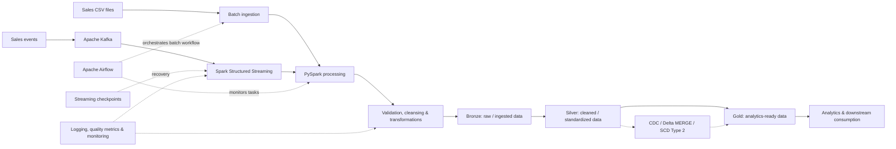

# PySpark Sales Data Engineering Pipeline

**Batch & streaming ETL | Apache Kafka | PySpark | Delta Lake | Apache Airflow | Docker**

A hands-on, production-inspired data engineering project that processes sales data through **batch and streaming pipelines**. The project combines **Apache Spark (PySpark)** for distributed transformations, **Apache Kafka** for event ingestion, **Delta Lake** for lakehouse-style storage and incremental updates, and **Apache Airflow** for workflow orchestration. It also explores practical reliability concerns: data quality, CDC, SCD Type 2 history, testing, observability, and streaming recovery.

> **Project status:** Completed portfolio project. This is a learning and demonstration environment, not a claim of a deployed, production-operated service.

## Architecture

The project covers complementary batch and streaming paths, which can be studied or run independently. The diagram is a logical view of the components and patterns implemented across the project; it is **not** a claim that every stage is part of one continuously deployed Airflow DAG.



**Batch workflow in the repository:**

```text
Sales CSV → Airflow FileSensor → Input Validation → PySpark ETL
          → Data Quality Checks → Parquet Output → Output Validation
```

The batch pipeline's Parquet publication path is distinct from the Delta Lake exercises and medallion/incremental-processing components.

## Key Capabilities

| Area | What the project demonstrates |
| --- | --- |
| **Batch ETL** | Schema-aware CSV ingestion, reusable PySpark transformations, validations, and Parquet output |
| **Event streaming** | Apache Kafka and Spark Structured Streaming for event-based ingestion and processing |
| **Lakehouse patterns** | Delta Lake with Bronze, Silver, and Gold data-layer concepts |
| **Incremental processing** | CDC processing, Delta `MERGE`, and SCD Type 2 historical dimension handling |
| **Orchestration** | Apache Airflow DAGs, source sensing, task dependencies, retries, failure propagation, and connections |
| **Data quality** | Schema checks, deduplication, validation rules, rejection thresholds, and quarantine-style handling |
| **Reliability** | Streaming checkpoints, restart/recovery practices, and repeatable processing considerations |
| **Performance** | Spark partitioning, broadcast joins, Adaptive Query Execution (AQE), caching, predicate pushdown, and shuffle awareness |
| **Observability** | Structured logging, pipeline metrics, and investigation of streaming throughput, lag, and processing health |
| **Testing** | `pytest` unit and integration checks for transformations and data processing logic |
| **Environment** | Dockerized Airflow and environment-specific YAML configuration |

## Technical Highlights

### 1. Batch ingestion and transformation

The batch workflow starts with a source file and validates that the required input is present before running a PySpark application. Transformations are organized into reusable modules rather than one monolithic script. Data-quality checks run before processed records are published to **Parquet**, and Airflow validates downstream output.

### 2. Kafka and Spark Structured Streaming

The streaming work integrates **Kafka** as an event source with **Spark Structured Streaming** for incremental processing. It also covers checkpoint persistence and recovery after restarts, plus operational considerations such as processing rate, source backlog, and safe retries.

### 3. Delta Lake and medallion architecture

The lakehouse work uses the following logical responsibilities:

- **Bronze:** preserve ingested data and source context.
- **Silver:** validate, clean, deduplicate, and standardize data.
- **Gold:** expose curated datasets for downstream reporting and analysis.

**Delta `MERGE`**, CDC transformations, and **SCD Type 2** patterns address incremental changes and historical dimensional records. The CDC work demonstrates change-processing logic; it does not imply a live database transaction-log connector such as Debezium.

### 4. Orchestration, quality, and observability

Airflow controls the lifecycle of the **batch** workflow using a file sensor, dependencies, retries, and failure handling. The application emits logs and processing metrics; tests and validation checks help detect unexpected inputs and incorrect transformations. Streaming monitoring concepts include throughput, backlog/lag, micro-batch progress, and checkpoint health.

### 5. Spark engineering and performance

The project includes practice with Spark execution and tuning patterns such as partitioning, broadcast joins, AQE, caching, predicate pushdown, and reducing avoidable shuffle work. These are engineering techniques explored in the project, not published benchmark or performance guarantees.

## Technology Stack

| Layer | Technologies |
| --- | --- |
| Language and processing | Python, Apache Spark, PySpark, Spark SQL |
| Streaming | Apache Kafka, Spark Structured Streaming |
| Storage and modeling | Parquet, Delta Lake, Bronze/Silver/Gold, CDC, SCD Type 2 |
| Orchestration | Apache Airflow |
| Environment | Docker, Docker Compose, YAML |
| Testing and reliability | pytest, logging, data-quality checks, checkpoints |

**Databricks note:** Databricks is part of the wider learning work associated with this project. The local repository's batch execution does not require a Databricks workspace; Databricks should not be understood as a required service for the commands below.

## Repository Structure

The following is the core structure documented for the original batch application. Other streaming/lakehouse modules may exist in newer commits; inspect the repository tree for their exact paths.

```text
pyspark-sales-etl/
├── airflow/
│   ├── dags/                   # Airflow DAG definitions
│   ├── Dockerfile             # Airflow image
│   ├── docker-compose.yaml    # Docker-based orchestration
│   └── requirements.txt
├── configs/
│   ├── dev.yaml               # Local configuration
│   └── docker.yaml            # Container configuration
├── data/                      # Local sample/input data
├── src/
│   ├── cdc/                   # CDC logic
│   ├── config/                # Configuration helpers
│   ├── dimensions/            # Dimension / SCD logic
│   ├── ingestion/             # Input handling
│   ├── pipelines/             # Pipeline coordination
│   ├── quality/               # Data quality checks
│   ├── transformations/       # PySpark transformations
│   └── utils/                 # Shared utilities
├── tests/                     # Automated tests
├── requirements.txt
└── run_batch_pipeline.py      # Local batch entry point
```

## Getting Started

### Prerequisites

- Python and Java versions compatible with the pinned PySpark dependencies
- Git
- Docker Desktop / Docker Engine with Docker Compose, for the Airflow environment
- A local Spark-compatible Java runtime (`JAVA_HOME` as needed)
- Kafka services and appropriate connector dependencies for the separate streaming workflow

### Clone and install

```bash
git clone https://github.com/Mahmoud-Jawabreh/pyspark-sales-etl.git
cd pyspark-sales-etl
python -m venv .venv
```

Activate the virtual environment:

```powershell
# Windows PowerShell
.\.venv\Scripts\Activate.ps1
```

```bash
# Linux / macOS
source .venv/bin/activate
```

Install application dependencies:

```bash
python -m pip install -r requirements.txt
```

### Run the local batch ETL

Ensure the expected source data and paths are configured in `configs/dev.yaml`, then run:

```bash
python run_batch_pipeline.py
```

The batch flow validates its inputs and writes processed data to the configured Parquet location. Exact input and output locations are environment-dependent.

### Start Airflow with Docker

From the repository root:

```bash
cd airflow
docker compose up --build -d
```

Open the Airflow web UI using the host port specified in `airflow/docker-compose.yaml`. Configure any required Airflow Connections or environment variables, then enable/trigger the batch DAG defined in `airflow/dags/`.

```bash
# Inspect containers
docker compose ps

# Inspect logs
docker compose logs -f

# Shut down the environment
docker compose down
```

### Run streaming and lakehouse components

The Kafka/Structured Streaming and Delta Lake work uses additional configurations and service dependencies. **Do not assume the batch entry point launches Kafka or the entire medallion flow.** Start the services and modules documented by the corresponding source files in your clone, and configure broker addresses, topics, checkpoint paths, and Delta destinations for your environment. Their exact CLI entry points are intentionally not guessed here.

## Testing

From the repository root with dependencies installed:

```bash
python -m pytest -v
```

The test suite focuses on transformation correctness and supporting ETL logic, including data handling, configuration, CDC, and dimensional-history behavior where corresponding tests are present.

## Reliability and Design Considerations

- **Data quality first:** use explicit schemas, validation, rejection thresholds, and quarantine patterns to keep invalid data from silently contaminating published datasets.
- **Recoverable streaming:** maintain stable checkpoint locations for a given logical streaming query; do not arbitrarily delete or reuse checkpoints across incompatible query changes.
- **Incremental correctness:** consider late arrivals, duplicate events, idempotent writes, and history tracking when applying CDC and Delta `MERGE`.
- **Operational visibility:** distinguish a running stream from a healthy stream by examining micro-batch progress, input/processing rates, lag, and errors.
- **Reproducible development:** isolate environment configuration and secrets rather than hard-coding machine-specific paths or credentials.

## Security and Repository Hygiene

Local `.env` files, credentials, logs, virtual environments, generated data outputs, and Spark checkpoint directories should remain out of version control. Review `git status` and `.gitignore` before pushing; never commit secrets or private datasets.

## Project Purpose

This repository is a technical portfolio project demonstrating practical data engineering skills across distributed batch processing, event streaming, incremental lakehouse design, workflow orchestration, reliability, and testing. It is intended for learning, reproducibility, and code review rather than advertising a managed production deployment.
