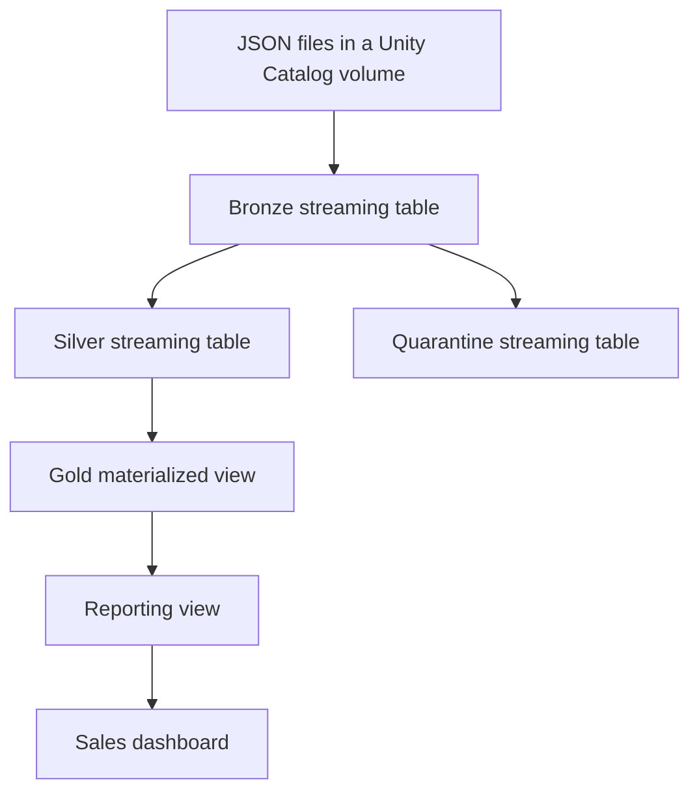

# Databricks Sales Lakehouse

A learning project demonstrating incremental file ingestion, governed
Delta datasets, data-quality checks, orchestration, SQL reporting,
and deployment with Databricks bundles.

Built and tested in Databricks Free Edition using a small synthetic dataset.

## Architecture



A Lakeflow Job updates the pipeline, then runs a validation notebook.
Validation runs only after the pipeline update succeeds.

## Components

| Component | Purpose |
|---|---|
| Auto Loader | Incrementally discovers and ingests JSON files |
| Unity Catalog | Governs tables, views, and volumes |
| Lakeflow pipeline | Manages dataset dependencies and streaming state |
| Expectations | Record validation results and exclude invalid Silver records |
| Quarantine table | Retains records requiring investigation |
| Lakeflow Job | Orchestrates the pipeline update and output validation |
| SQL warehouse | Executes reporting and dashboard queries |
| Deployment bundle | Versions and deploys pipeline and job definitions |

## Project Files

| Location | Contents |
|---|---|
| `databricks.yml` | Bundle configuration and deployment target |
| `resources/` | Pipeline and job resource definitions |
| `src/` | Pipeline source files and validation notebook |
| `sql/reporting.sql` | Reporting-view creation SQL |
| `dashboards/sales_lakehouse_overview.lvdash.json` | Exported dashboard definition |

## Published Datasets

Datasets are published under the configured catalog and schema.
The learning environment uses `workspace.de_learning`.

| Dataset | Type |
|---|---|
| `lf_bronze_sales` | Streaming table |
| `lf_silver_sales` | Streaming table |
| `lf_quarantine_sales` | Streaming table |
| `lf_gold_product_sales` | Materialized view |
| `vw_product_sales_reporting` | Ordinary reporting view |

## Data Quality

Records are accepted into Silver when:

- `sale_id` is present.
- `product` is present and not blank.
- `quantity` is greater than zero.
- `price` is nonnegative.
- `_rescued_data` is null.

Bronze preserves parsed records and records expectation metrics.
Silver excludes records that fail validation.
Quarantine retains those rejected records for investigation.

Unexpected fields, such as the exercise's `discount` field, are rescued
and quarantined pending a decision about their meaning.

File-processing progress does not enforce uniqueness of business keys.

## Configuration and Prerequisites

The existing learning workspace must contain:

- The configured catalog and `de_learning` schema.
- The `sales_landing` volume and source JSON files.
- A usable SQL warehouse.
- Appropriate permissions for the executing identity.

Set the following entry in the pipeline's Configuration:

| Key | Learning value |
|---|---|
| `sales.source_path` | `/Volumes/workspace/de_learning/sales_landing/lesson_05/incoming` |

The Python pipeline reads this value using `spark.conf.get()`.

The validation notebook accepts:

| Parameter | Purpose |
|---|---|
| `catalog_name` | Catalog containing pipeline outputs |
| `schema_name` | Schema containing pipeline outputs |
| `max_quarantine_ratio` | Maximum permitted fraction of quarantined records |
| `job_run_id` | Execution identifier included in notebook output |

The learning threshold is `0.50`, allowing the intentionally rejected
fixture records. It is not a recommended production threshold.

Bundle deployment does not provision the source files, recreate their
delivery history, or automatically apply the standalone reporting SQL.

## Authentication

Install the current Databricks CLI, then authenticate to the workspace:

```powershell
databricks auth login --host "https://YOUR_WORKSPACE_HOST" --profile DATABRICKS_LEARNING
```

Replace the workspace host and ensure it matches the bundle target.

Credentials and local deployment state must remain outside version control.

## Validate, Deploy, and Run

Run these commands from the folder containing `databricks.yml`.

Validate the bundle configuration:

```powershell
databricks bundle validate --target learning --profile DATABRICKS_LEARNING
```

Deploy the reviewed configuration and source files:

```powershell
databricks bundle deploy --target learning --profile DATABRICKS_LEARNING
```

Run a bundled resource:

```powershell
databricks bundle run --target learning --profile DATABRICKS_LEARNING
```

When prompted, select the job resource corresponding to
`sales_lakehouse_workflow`.

The job runs:

1. `refresh_sales_pipeline`
2. `validate_sales_outputs`

Existing workspace resources were linked to this bundle using
`bundle deployment bind`. A fresh checkout requires the appropriate
deployment identity and access to the existing bundle deployment state.

## Output Validation

The validation notebook checks:

- Bronze is nonempty for this exercise.
- Bronze row count equals Silver plus Quarantine row counts.
- The quarantine ratio is within the configured limit.
- Total Gold revenue equals total Silver sale amounts.

With the four learning input files, expected results are:

| Dataset | Rows |
|---|---:|
| Bronze | 6 |
| Silver | 4 |
| Quarantine | 2 |
| Gold | 4 |

Expected accepted revenue: **5840.00**.

These checks do not establish complete business correctness, freshness,
or uniqueness.

## Reporting Setup

After the pipeline has produced Gold:

1. Run `sql/reporting.sql` in the Databricks SQL Editor.
2. Import the `.lvdash.json` file through the dashboard import interface.
3. Select an available SQL warehouse and verify the dataset references.
4. Refresh the dashboard.

Expected dashboard totals:

- Revenue: **5840.00**
- Units sold: **6**

## Recovery Exercise Completed

The workflow was tested by:

1. Running successfully with a quarantine threshold of `0.50`.
2. Lowering the threshold to `0.10`, causing validation to fail.
3. Restoring the threshold to `0.50`.
4. Repairing the failed run.

A failed validation task does not roll back the completed pipeline update.

Normal pipeline updates preserve ingestion progress. Full refreshes have
different semantics and rebuild streaming outputs from available input.